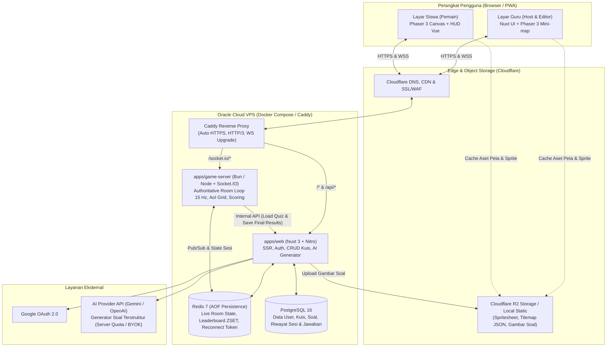

# PRD — Petakuis (Nuxt)

Nov 10, 2026 · @Dinar Permadi

## Ringkasan

Petakuis adalah platform kuis kelas berbasis web dengan dunia pixel art bergaya RPG klasik (top-down, mirip game petualangan 2D). Siswa menggerakkan avatar di peta, mengikuti penunjuk arah ke titik kuis, lalu berlomba menjawab: yang benar dan paling cepat mendapat poin terbanyak. Produk ini terinspirasi [ZEP QUIZ](https://quiz.zep.us) dan dibangun dengan Nuxt + Bun monorepo.

- **Masalah:** kuis kelas seperti Kahoot atau Quizizz terasa monoton setelah beberapa kali dipakai, karena siswa hanya menekan tombol di layar.
- **Solusi:** menambahkan eksplorasi ruang. Siswa harus *menemukan* soal di peta sebelum menjawab, sehingga ada unsur gerak, strategi, dan kompetisi.
- **Target awal:** guru SD–SMA di Indonesia dan sekolah yang memakai Google Classroom.
- **Model akses:** **100% Gratis (Akses Terbuka Tanpa Paywall)** untuk semua guru dan siswa. Seluruh peta, mode permainan, kapasitas hingga 200 pemain per sesi, dan laporan analitik dapat digunakan penuh tanpa biaya langganan, didukung efisiensi hosting mandiri di Oracle Cloud VPS.

Catatan: aset visual (karakter, tileset) wajib orisinal atau berlisensi komersial yang sah, diproduksi melalui pipeline [aldegad/sprite-gen](https://github.com/aldegad/sprite-gen) untuk menghasilkan sprite sheet transparan dan manifest kompatibel Phaser 3. Jangan memakai karakter, sprite, atau nama dari franchise pihak ketiga (seperti Pokémon).

**Brand:** nama produk Petakuis. Domain yang belum terdaftar per 10 November 2026: petakuis.com, petakuis.id, petakuis.app, petakuis.net. Handle TikTok @petakuis tampaknya belum dipakai. Cek merek di PDKI (kelas 9 dan 41) dan username Instagram belum dilakukan.

## Temuan Riset Referensi (ZEP QUIZ via REA)

Hasil observasi dan reverse-engineering pada aplikasi web `quiz.zep.us` (Evidence REA: `ev_2cac055823a648eb3ff5b3c0646e569cb6bde255d5581ca2012633f3d2c3797a`, `ev_027c8df1a196be02d0746a2fac8c7777e21e6a6104961e342005612f51005660`, `ev_55cd50f36f14b1782d982a63ec1c017e3daba03ffb958665b816a67ac9b66abc`, `ev_d4534be2c382c04d7fe5b81e202e41559f09f0e6dc7becb1f23cb5ad242bc0e5`, `ev_51b81d4da9a573ed72c4ade206fb105020edbb47d40f9399a2e13d84c470a44d`) memberikan patokan produk nyata yang diadopsi dan disederhanakan untuk Petakuis:

1. **Onboarding Pembuatan Kuis Tanpa Hambatan (`/id/build`):**
   - Guru bisa langsung membuka halaman pembuat kuis (bahkan mencoba sebagai tamu sebelum menyimpan) dengan alur: **Pilih Peta** (beserta tombol **Coba / Preview** langsung) → **Pilih Jenjang & Mata Pelajaran** (`SD`, `SMP`, `SMA`, `TK`, `Kuliah`, `Lainnya`; mata pelajaran lokal Indonesia: Matematika, Bahasa Indonesia, IPA, Sosiologi, Bahasa Inggris, Seni, Olahraga, TIK, PPKn, Agama) → **Editor Soal**.
2. **Struktur Soal & Atribut Kuis (`live-quiz-api`):**
   - Mendukung tipe soal: `multiple` (Pilihan ganda, tunggal maupun *multiple-answer*), `ox` (Benar/Salah), dan `subjective` (Isian singkat dengan opsi `ignoreSpaces: true` dan pencocokan *case-insensitive*). Tipe `Esai`, `Pencocokan`, dan `Pengurutan` ditaruh di Fase 2.
   - Setiap soal memiliki atribut `hint` opsional (berupa teks atau gambar petunjuk) dan opsi pengacakan urutan pilihan (`Acak urutan pilihan`).
   - Pengaturan kuis mencakup `isAllowPass` (izinkan lewati soal), `showIncorrectAnswer` (tampilkan koreksi saat salah), dan `answerRevealMode` (`always` / `after_end`).
   - Kode masuk sesi (`enterCode`) berupa angka 6–7 digit yang mudah diketik siswa di `/join` atau dipindai lewat QR.
3. **Katalog Peta & Mode Permainan (`templates`):**
   - ZEP QUIZ membagi peta ke dalam 5 mekanik (`free` / Bebas, `linear` / Berurutan, `round` / Ronde, `team` / Pertandingan tim, `coop` / Mode Kerja Sama) dan mengunci sebagian besar peta di balik paket berbayar (`BASIC`, `PRO`).
   - Di **Petakuis**, seluruh peta dibuka **100% gratis tanpa gembok tier**. Untuk MVP, fokus pada 2 mekanik dasar di atas mesin peta yang sama: **Bebas (Free Roam)** di mana siswa mencari soal dalam urutan apa pun, dan **Berurutan (Linear)** di mana penunjuk arah menuntun siswa dari Soal #1 hingga selesai secara berurutan.
4. **Pemisahan Web App & Engine Game:**
   - ZEP memisahkan aplikasi manajemen kuis (`quiz.zep.us` + `live-quiz-api`) dari engine ruang permainan (`zep.us/play/:id` dengan renderer WebGL + spritesheet terkombinasi `floor-render-combined.png`, `wall-render-combined.png`, `navigator.png`, `moveMarker.png`, `movePin.png`).
   - Di Petakuis, Nuxt menangani manajemen kuis dan langsung merender komponen `<GameCanvas.client.vue>` berbasis Phaser 3 di halaman `/play/[code]` dan `/host/[code]` tanpa overhead iframe lintas domain, terhubung ke proses `game-server` lewat WebSocket.

## Tujuan dan metrik sukses

MVP dianggap berhasil kalau guru bisa membuat kuis dan menjalankan sesi untuk 40 siswa sekaligus tanpa lag yang terasa, dalam waktu kurang dari 10 menit dari daftar.

**Tujuan**

1. Guru membuat kuis (manual, impor CSV, atau dibantu AI) dan meluncurkan sesi dalam ≤ 10 menit.
2. Siswa bergabung lewat kode 6 digit atau QR tanpa akun, langsung bermain di browser HP atau laptop.
3. Sesi realtime stabil hingga 200 pemain per room di atas infrastruktur VPS Oracle Cloud.
4. Seluruh fitur dan peta dapat diakses 100% gratis oleh guru di Indonesia tanpa hambatan paywall.

**Bukan tujuan (untuk MVP)**

- Aplikasi native iOS/Android (cukup web responsif/PWA).
- Editor peta bebas oleh guru (peta dibuat tim internal dulu menggunakan Tiled + `sprite-gen`).
- Voice/video chat (WebRTC) antar pemain (di ZEP fitur ini dimatikan secara default pada mode kuis: `disableChat: true`, `hideAllUi: true`).
- Sistem pembayaran, langganan berbayar, atau marketplace kuis berbayar.

**Metrik**

| Metrik | Target 3 bulan setelah rilis |
| --- | --- |
| Guru aktif mingguan | 500 |
| Sesi per guru aktif per minggu | ≥ 2 |
| Siswa bergabung per sesi (median) | ≥ 25 |
| Waktu buat kuis pertama | ≤ 10 menit |
| Kuis publik yang dibagikan ke komunitas | ≥ 300 kuis |
| Latensi sinkron posisi (p95) | ≤ 150 ms |

Angka target adalah asumsi awal dan perlu divalidasi tim.

## Persona dan user stories

Ada dua pengguna utama: guru yang membuat dan menjalankan kuis, serta siswa yang bermain di kelas maupun secara mandiri.

| Persona | Kebutuhan utama | Perangkat |
| --- | --- | --- |
| Guru (host) | Buat kuis cepat tanpa batasan fitur berbayar, pantau kelas, lihat hasil per siswa | Laptop + proyektor |
| Siswa (pemain) | Masuk tanpa ribet, main seru, lihat peringkat | HP Android kelas menengah, Chromebook |

**User stories (MVP)**

- Sebagai guru, saya ingin memilih peta (dengan fitur pratinjau/coba peta) dan jenjang/mata pelajaran sebelum membuat soal.
- Sebagai guru, saya ingin membuat kuis pilihan ganda (`multiple`), benar/salah (`ox`), dan isian singkat (`subjective`) lengkap dengan gambar atau petunjuk (`hint`) agar bisa dipakai lintas mata pelajaran.
- Sebagai guru, saya ingin AI membuat draf soal dari topik atau teks materi agar hemat waktu ( ≤ 3 menit).
- Sebagai guru, saya ingin memilih mode permainan (Bebas / Berurutan) sebelum sesi dimulai.
- Sebagai guru, saya ingin melihat layar host berisi peta kelas, posisi seluruh siswa, dan leaderboard langsung.
- Sebagai siswa, saya ingin masuk dengan kode 6 digit atau QR dan nama panggilan, tanpa membuat akun.
- Sebagai siswa, saya ingin penunjuk arah yang jelas ke soal berikutnya agar tidak tersesat di peta.
- Sebagai siswa, saya ingin tahu langsung apakah jawaban saya benar dan berapa poin yang saya dapat.
- Sebagai guru, saya ingin laporan per soal dan per siswa setelah sesi, dan bisa diekspor ke CSV (kompatibel dengan format nilai Google Classroom).

## Alur pengguna utama

Satu sesi berjalan dari pemilihan peta, pembuatan soal, lobi, permainan di peta, hingga laporan hasil. Guru mengendalikan kapan setiap fase dimulai.

1. **Guru membuat kuis.** Klik Buat Kuis → Pilih peta (bisa klik "Coba" untuk pratinjau) → Pilih jenjang (SD/SMP/SMA/Lainnya) & mata pelajaran → Tambah soal (manual, impor CSV, atau AI dari topik/teks) → Atur waktu per soal, poin, dan opsi pengacakan → Simpan.
2. **Guru meluncurkan sesi.** Pilih mode (Bebas / Berurutan) → Sistem membuat room dengan kode 6 digit dan QR → Layar host masuk ke lobi.
3. **Siswa bergabung.** Buka link atau scan QR → Masukkan nama panggilan → Pilih avatar & variasi warna → Muncul di area tunggu lobi.
4. **Guru menekan Mulai.** Semua avatar muncul di titik awal peta. Soal-soal tersebar sebagai objek interaktif (peti, papan pengumuman, kristal, NPC) di peta.
5. **Siswa menjelajah.** Penunjuk arah (panah `navigator` di tepi layar + label jarak dalam langkah) mengarah ke objek soal terdekat yang belum dijawab.
6. **Siswa menjawab.** Saat avatar mendekati objek soal dan menekan tombol aksi (atau menyentuh objek), panel soal terbuka. Server menilai jawaban, menghitung poin dari ketepatan dan kecepatan, lalu memperbarui leaderboard.
7. **Sesi berakhir.** Saat waktu habis, semua siswa menyelesaikan seluruh soal, atau guru menekan Selesai → Animasi podium 3 besar → Laporan lengkap untuk guru.
8. **Setelah sesi.** Guru melihat statistik per soal (persentase benar, rata-rata waktu jawab) dan per siswa, serta mengekspor CSV. *(Catatan: pembagian kuis sebagai tugas mandiri/Mode PR dijadwalkan untuk Fase 2).*

Kalau koneksi siswa putus, ia bisa masuk lagi dari perangkat yang sama (`reconnect_token` di `localStorage`) atau memasukkan kode dan nama yang sama dalam 5 menit, lalu progres soal dan skornya dipulihkan dari Redis.

## Kebutuhan fungsional

MVP mengutamakan **kualitas keluasan dunia dibanding kuantitas peta kecil**: alih-alih menyediakan banyak peta sempit yang cepat habis dijelajahi, Petakuis menyediakan **3 Peta Multi-Region Berskala Luas (Seamless Open World)** dengan 3 gaya tileset berbeda yang semuanya **100% gratis** dan dapat langsung diganti secara instan melalui fitur **Ganti Peta Demo (Live Tilemap Switcher)** di layar permainan:

1. **Pesisir Karang · Kampung Nelayan (`64×48` tile, menggantikan peta berbasis aset pihak ketiga sejak 11 November 2026):**
   - Kampung nelayan dengan pantai berbuih, dermaga kayu, rumah panggung, mercusuar, dan pulau kecil bertitian. Disusun di Godot dari paket Sunnyside World.
   - Peta tambahan dengan pipeline yang sama: **Dataran Tinggi Angin** (undakan tebing, kincir angin, sungai) dan **Kota Pasar** (alun-alun pasar, kanal, balai kota).
2. **Lembah Raya Sunnyside & Farm RPG · ZEP Village World (`56×44` tile / `2688×2112` px efektif):**
   - Dirancang menggunakan paket aset `Farm RPG FREE 16x16` dan `Sunnyside World V2.1`, menghubungkan 4 zona desa dalam satu peta luas: **Alun-Alun Desa Sunnyside** (pondok merah & biru), **Kawasan Perkebunan & Lumbung Timur**, **Hutan Maple Utara & Danau Kembar**, serta **Balai Belajar Selatan**.
3. **Kompleks Kampus & Perpustakaan Modern · Indoor School Region (`48×36` tile / `2304×1728` px efektif):**
   - Dirancang menggunakan paket aset `Modern tiles_Free (16x16)`, menghubungkan 4 sayap bangunan sekolah dalam satu denah kampus luas: **Sayap Ruang Kelas Utama** (papan tulis hijau, meja guru, deretan bangku siswa), **Sayap Perpustakaan Raya** (deretan rak buku, meja baca, globe), **Laboratorium Sains & Komputer**, dan **Aula Koridor Tengah**.

| Modul | Fitur | Prioritas |
| --- | --- | --- |
| Autentikasi | Login guru via Google OAuth dan email magic link / OTP 6 digit | MVP |
| Autentikasi | Siswa masuk sebagai tamu (kode room + nama), tanpa akun | MVP |
| Katalog Peta | Dialog pemilih peta dengan filter Mode (Bebas/Berurutan) dan Pratinjau Peta (*Coba*) | MVP |
| Editor kuis | Metadata jenjang sekolah & mata pelajaran Kurikulum Indonesia | MVP |
| Editor kuis | Soal pilihan ganda (`multiple`), benar/salah (`ox`), isian singkat (`subjective` dengan `ignoreSpaces`), gambar & `hint` per soal | MVP |
| Editor kuis | Timer per soal, bobot poin, acak urutan soal/opsi, pengaturan `isAllowPass` & `showIncorrectAnswer` | MVP |
| Editor kuis | Impor soal dari CSV/Excel | MVP |
| Editor kuis | Generator soal AI dari topik atau teks materi (kuota wajar harian gratis + dukungan BYOK API Key pribadi) | MVP |
| Editor kuis | Ekstraksi soal AI dari dokumen PDF/file atau link YouTube, terjemahan soal AI, soal serupa otomatis | Fase 2 |
| Editor kuis | Tipe soal lanjutan: Pencocokan (`matching`), Pengurutan (`ordering`), Esai, dan editor rumus LaTeX | Fase 2 |
| Perpustakaan | Tab Jelajah: kuis publik yang bisa dicari per mata pelajaran dan disalin guru lain | Fase 2 |
| Sesi live | Buat room hingga 200 pemain, kode 6 digit, QR, lobi interaktif, tombol Mulai/Jeda/Selesai | MVP |
| Sesi live | Layar host: peta kelas live, posisi semua siswa, progres pengerjaan, leaderboard live | MVP |
| Sesi live | Kick pemain, filter kata tidak pantas (Bahasa Indonesia & Inggris) pada nama panggilan | MVP |
| Game | Peta tile pixel, gerak avatar 4 arah (keyboard WASD/panah, joystick virtual & tap-to-move di HP) | MVP |
| Game | Penunjuk arah (`navigator`) ke objek soal + indikator jarak + penanda di atas objek (`movePin`) | MVP |
| Game | Mode permainan tambahan: Ronde (`round`), Pertandingan Tim (`team`), Kooperatif Bos/Madu (`coop`) | Fase 2 |
| Game | Kostum/avatar yang bisa dibuka dengan poin kelas | Fase 3 |
| Laporan | Statistik per soal, per siswa, dan ringkasan kelas; ekspor CSV | MVP |
| Laporan | Dashboard tren kelas lintas sesi dan cetak lembar kerja/worksheet PDF | Fase 2 |
| Mode PR | Kuis mandiri asinkron dengan tenggat waktu, tanpa host live | Fase 2 |
| Integrasi | Google Classroom: bagikan link langsung dan sinkronisasi nilai otomatis | Fase 2 |

## Mekanik game & pipeline aset (`aldegad/sprite-gen`)

Inti permainan: temukan soal di peta, jawab dengan benar, dan jawab lebih cepat dari yang lain. Server yang menilai semua jawaban dan menghitung semua skor, bukan browser siswa.

**Pipeline Aset Visual (`sprite-gen` + Tiled)**

Untuk memastikan seluruh karakter, objek interaktif, dan tileset 100% orisinal, konsisten di atas grid pixel, dan bebas masalah hak cipta, pembuatan aset menggunakan alur kerja [aldegad/sprite-gen](https://github.com/aldegad/sprite-gen):

1. **Pembuatan Sprite Karakter & NPC (Pipeline A · Atlas Rows):**
   - Dari satu gambar konsep dasar per karakter (`prepare` → `gen-set` → `extract` → `compose-atlas`), dihasilkan `sprite-sheet-alpha.png` dengan alpha transparan bersih (tanpa tepi warna bocor/fringe berkat *chroma unmixing*) dan terikat pada grid pixel (*Backbone Lattice*).
   - Animasi diam (*idle*) diproses dengan fitur **Breathe** (squash & stretch deterministik), disertai baris animasi jalan 4 arah.
2. **Variasi Warna Siswa & Tim (`recolor`):**
   - Menggunakan perintah `sprite-gen recolor` untuk menghasilkan 8–12 variasi warna seragam/avatar secara deterministik dari satu sprite sheet dasar, menghemat ukuran unduhan dan memori tekstur di HP kelas bawah.
3. **Ekspor Langsung ke Phaser 3 (`export-phaser`):**
   - Menghasilkan `manifest.json.frame_layout` dan format JSON Atlas standar Phaser 3 sehingga scene `BootScene` di Nuxt langsung memuat frame tanpa menebak ukuran grid secara manual.
4. **Tileset & Bayangan (`background-tile` & `shadow`):**
   - Tile tanah/dinding seamless dibuat dengan `sprite-gen background-tile` dan bayangan karakter/objek diproyeksikan dengan `sprite-gen shadow`, kemudian disusun di [Tiled](https://www.mapeditor.org) (ukuran tile 16×16 px, skala render 3×) menjadi lapisan `floor`, `wall/collision`, `decoration`, dan `spawn_points`.

**Peta, collision 2D, dan isolasi layer UI**

- Peta grid tile 16×16 px berskala multi-region (`48×36` hingga `60×50` tile), dirender dengan skala 3× (48×48 px efektif per tile di layar) sehingga menghasilkan dunia eksplorasi luas hingga `2880×2400` px.
- **Collision 2D presisi (`move_and_slide` + BFS Pathfinding):** Setiap peta menyertakan matriks `collisionRows` per-tile (`'#'` solid, `'.'` jalan/lantai) dan daftar `obstacles` yang divalidasi di klien maupun server. Pergerakan menggunakan pemisahan sumbu X/Y bergaya Godot (`slideMovePlayer`) dengan hitbox kaki karakter sehingga pemain tidak dapat menembus rumah, atap, meja kelas, rak buku, pohon, pagar, maupun air. Ketuk lokasi (*tap-to-move*) menggunakan algoritma BFS (`findTilePathBFS`) untuk memutari gedung dan rintangan secara otomatis.
- **Isolasi Stacking Context UI (`isolation: isolate`):** Kontainer dunia peta (`<GameCanvas.client.vue>`) wajib menggunakan `isolation: isolate` (`z-index: 0`) dengan nilai `z-index` internal Y-sorting dibatasi pada rentang `1..80`. Komponen HUD atas/bawah menggunakan `z-[1000]` dan modal pertanyaan (`<QuestionModal.vue>`) menggunakan `z-[2000]` agar sprite karakter maupun pin objek soal (`! #1`) tidak pernah menutupi atau menghalangi dialog soal.
- **Live Tilemap Switcher (Demo Lintas Tilemap):** Bilah atas pada halaman `/play/[code]` dan `/host/[code]` menyediakan pemilih peta instan agar guru maupun penguji dapat langsung berpindah antar-tilemap (GBA Region, Sunnyside Farm RPG Region, dan Kompleks Kampus Modern) secara langsung di dalam sesi aktif.
- Gerak 4 arah dengan animasi jalan + idle. Keyboard (WASD/panah + Spasi/F untuk interaksi) di laptop, D-Pad virtual atau ketuk lokasi (*tap-to-move*) di HP.
- Kamera mengikuti avatar pemain. Pemain lain terlihat sebagai avatar dengan nama panggilan di atas kepala.

**Penunjuk arah & distribusi objek soal**

- Panah `navigator` di tepi layar menunjuk ke objek soal terdekat yang belum dijawab oleh siswa tersebut, lengkap dengan label jarak (misalnya `"12 langkah"`).
- Saat objek masuk ke area pandang kamera, panah tepi layar berubah menjadi penanda `movePin` yang memantul di atas objek soal.
- **Kapasitas titik soal dinamis:** Setiap peta memiliki minimal 20 titik objek soal (`spawn_points`). Jika kuis memiliki $\le 20$ soal, setiap soal ditempatkan pada satu objek unik (diacak per siswa pada mode **Bebas** agar siswa tidak bisa saling mencontek lokasi soal tertentu, atau diurutkan pada mode **Berurutan**). Jika kuis memiliki $> 20$ soal, objek yang sudah dijawab akan terisi ulang (*respawn*) dengan soal berikutnya setelah jeda singkat.

**Menjawab dan skor**

- Menyentuh objek atau menekan tombol interaksi di dekat objek membuka panel soal; avatar berhenti selama panel terbuka.
- Setiap soal hanya bisa dijawab sekali per siswa (kecuali guru mengaktifkan `isAllowPass` untuk melewati dan kembali lagi sebelum dijawab). Objek berubah visual (misalnya peti terbuka / warna redup) setelah dijawab.
- Aturan penilaian soal Isian Singkat (`subjective`): teks di-trim, diubah ke huruf kecil (*case-insensitive*), mendukung opsi `ignoreSpaces` (abaikan spasi), dan mencocokkan terhadap daftar jawaban benar yang diterima guru.
- Poin dihitung di server berdasarkan waktu respons sejak soal pertama kali dibuka oleh siswa tersebut:

$$\text{poin} = \text{bobot} \times \left(0{,}5 + 0{,}5 \times \frac{T - t}{T}\right)$$

- $T$ = batas waktu soal (detik), $t$ = selisih waktu jawab siswa sejak `first_opened_at` di server (dibatasi maksimal $T$). Jawaban salah = 0 poin.
- Bonus kecepatan kelas: **+10% poin tambahan** untuk 3 penjawab benar pertama pada soal yang sama di satu sesi.

**Anti-curang & keadilan aksesibilitas**

- **Kunci jawaban hanya di server:** Payload `question:show` hanya mengirim teks soal, gambar, petunjuk, dan daftar pilihan tanpa atribut `answer`.
- **Anti-reset timer saat reconnect:** Server menyimpan timestamp `first_opened_at` per `(session_id, player_id, question_id)` di Redis. Menutup tab atau me-refresh halaman setelah melihat soal tidak akan mengulang waktu $t$ dari nol.
- **Validasi posisi & kecepatan:** Server memvalidasi jarak Euclidean/Manhattan antara posisi `(x, y)` pemain di server dan koordinat objek sebelum mengizinkan `question:open`, serta menolak paket `move` yang melebihi kecepatan gerak maksimum (anti-teleport).
- **Mode Aksesibel yang adil:** Untuk siswa dengan hambatan motorik/visual yang mengaktifkan Mode Aksesibel (menjawab tanpa menggerakkan avatar di peta), fitur ini hanya bisa diaktifkan atas persetujuan Host atau memiliki jeda perpindahan antar-soal (*travel cooldown* 4 detik) agar tetap adil terhadap siswa yang berjalan di peta.

## Model Akses Gratis & Keberlanjutan Infrastruktur

Berbeda dari ZEP QUIZ yang membatasi peta, jumlah pemain, dan fitur di balik paket langganan berbayar (`Basic` Rp50.833/guru/bln dan `Pro` Rp60.000/guru/bln), **Petakuis dibuat 100% gratis untuk seluruh guru dan siswa**.

Keberlanjutan biaya operasional dicapai melalui efisiensi arsitektur teknis:

| Komponen | Kebijakan Akses Gratis | Strategi Efisiensi Biaya |
| --- | --- | --- |
| Biaya Langganan | **Rp0 (100% Gratis)** | Tanpa payment gateway, tanpa paywall, semua fitur terbuka |
| Pemain bersamaan per sesi | Hingga **200 siswa/room** | Berjalan di atas Oracle Cloud VPS (Ampere A1 ARM64) dengan biaya tetap rendah/Always Free tier |
| Jumlah kuis & akses peta | **Tak terbatas** & **Semua peta terbuka** | Aset peta statis & sprite sheet di-cache di Cloudflare CDN/R2 (bebas biaya bandwidth egress) dan Service Worker PWA |
| Tipe soal & analitik | **Semua tipe soal & ekspor CSV terbuka** | Pemrosesan penuh di PostgreSQL & Redis internal di VPS |
| Generator soal AI | **Kuota harian wajar gratis + Opsi BYOK** | Menggunakan model cepat/hemat (Gemini Flash) dengan caching topik di Redis; guru juga dapat memasukkan API Key pribadi (*Bring Your Own Key*) untuk pembuatan tanpa batas |
| Pengaturan kuis (Publik / Privat) | **Bebas pilih** | Guru bebas membagikan kuis ke perpustakaan komunitas (Jelajah) atau menyimpannya secara privat |

## Arsitektur teknis (Nuxt + Bun + Oracle Cloud VPS)

Sistem dirancang agar seluruh komponen dapat berjalan mandiri (*self-hosted*) di atas **Oracle Cloud Infrastructure (OCI) VPS** (seperti instance Ampere A1 ARM64 4 OCPUs / 24 GB RAM atau AMD Compute di region **Singapore `ap-singapore-1`** yang memiliki latensi ~12–25 ms ke jaringan ISP Indonesia).



Guru dan siswa sama-sama terhubung ke `game-server` lewat WebSocket. Saat sesi dibuat, Nuxt menyiapkan metadata sesi di Redis; `game-server` memuat soal (beserta kunci jawaban di memori tertutup server) dan menjalankan simulasi gerak serta penilaian secara *real-time*. Setiap jawaban siswa langsung dicatat ke Redis (`HSET` + `ZADD` untuk leaderboard) sehingga jika proses restart di tengah jalan, tidak ada skor yang hilang, lalu disinkronkan secara batch ke PostgreSQL saat sesi berakhir.

**Stack**

| Lapisan | Pilihan | Alasan |
| --- | --- | --- |
| Runtime & Monorepo | **Bun** (Workspaces) | Eksekusi TypeScript cepat, manajemen paket tunggal, hemat memori di VPS |
| Framework Web | **Nuxt** (struktur `app/` terbaru, TypeScript) | SSR untuk halaman publik/landing, SPA/CSR cepat untuk layar game, Nitro API |
| UI & Styling | **Nuxt UI + Tailwind CSS** | Komponen form, modal, tabel, dan aksesibilitas keyboard bawaan |
| State Klien | **Pinia** | Store sesi ruang tunggu, state pemain, dan HUD soal |
| Game Engine | **Phaser 3** (di komponen `.client.vue`, dynamic chunk) | Tilemap Tiled JSON, Arcade Physics, kamera, animasi atlas `sprite-gen`, input sentuh |
| Realtime Server | **Socket.IO** + `@socket.io/redis-adapter` | Manajemen room, auto-reconnect, fallback long-polling untuk Wi-Fi sekolah ketat |
| Database Utama | **PostgreSQL 16 + Drizzle ORM** | Skema bertipe kuat, migrasi cepat, query analitik laporan efisien |
| State Live & Cache | **Redis 7** (dengan AOF aktif) | State posisi room, leaderboard (`ZSET`), timer soal, rate limit |
| Autentikasi | `nuxt-auth-utils` (Google OAuth + Magic Link/OTP, sesi cookie `httpOnly`) | Ringan, native Nitro tanpa dependensi berat |
| Internasionalisasi | `@nuxtjs/i18n` | Bahasa Indonesia (`id`, default) dan Inggris (`en`) |
| PWA | `@vite-pwa/nuxt` | Pre-cache aset tileset dan sprite sheet agar hemat kuota siswa |
| Object Storage | **Cloudflare R2** atau penyimpanan lokal VPS | Bebas biaya egress untuk gambar soal, JSON peta, dan atlas sprite |
| Infrastruktur Deploy | **Oracle Cloud VPS** + **Docker Compose** + **Caddy** | Biaya tetap sangat rendah/gratis, resource CPU/RAM besar untuk menangani ratusan room aktif |

**Struktur repo (Bun workspaces monorepo)**

```text
petakuis/
  apps/
    web/                        # Aplikasi Nuxt (SSR + Dashboard Guru + Klien Game)
      app/
        pages/
          index.vue             # Landing page & daftar peta interaktif
          explore.vue           # Perpustakaan kuis publik komunitas guru
          join.vue              # Halaman masuk siswa (kode 6 digit)
          build/index.vue       # Wizard pilih peta, jenjang/mapel, & editor kuis
          dashboard/index.vue   # Daftar kuis guru & riwayat sesi
          quiz/[id]/edit.vue    # Editor kuis tersimpan
          host/[code].vue       # Layar host guru (lobi, peta live, leaderboard)
          play/[code].vue       # Layar game siswa
          report/[id].vue       # Laporan analitik pasca-sesi & ekspor CSV
        components/
          game/GameCanvas.client.vue
          game/QuestionModal.vue
          game/VirtualJoystick.vue
          quiz/MapSelectorModal.vue
          quiz/QuestionEditor.vue
          quiz/AiGeneratorModal.vue
          host/LiveLeaderboard.vue
        composables/
          useGameSocket.ts
        stores/
          useSessionStore.ts
          useQuizEditorStore.ts
        game/                   # Scene & sistem Phaser 3
          scenes/BootScene.ts
          scenes/MapScene.ts
          entities/PlayerAvatar.ts
          systems/NavigatorArrow.ts
      server/
        api/                    # Endpoint Nitro (lihat tabel API)
        db/
          schema.ts             # Skema Drizzle PostgreSQL
          migrations/
        utils/
      public/
        maps/                   # JSON Tiled & tileset WebP
        sprites/                # Output atlas & manifest dari aldegad/sprite-gen
    game-server/                # Server Realtime (Bun/Node + Socket.IO)
      src/
        index.ts
        rooms/QuizRoom.ts       # Game loop 15 Hz, AoI filtering, state sesi
        scoring.ts              # Kalkulasi poin & bonus 3 penjawab tercepat
        antiCheat.ts            # Validasi jarak objek, kecepatan, & timer Redis
  packages/
    shared/                     # Tipe TypeScript, konstanta, & kontrak event Socket.IO
      src/
        events.ts
        types.ts
        scoring.ts
  tools/
    assets/                     # Konfigurasi & skrip pipeline aldegad/sprite-gen
  docker-compose.yml            # Orkestrasi produksi untuk Oracle Cloud VPS
  Caddyfile                     # Konfigurasi reverse proxy HTTPS & WebSocket
```

**Model data (PostgreSQL — Drizzle ORM)**

| Tabel | Kolom utama |
| --- | --- |
| `users` | `id`, `email`, `name`, `avatar_url`, `role` (`teacher`/`admin`), `school_name`, `created_at` |
| `maps` | `id`, `slug`, `name`, `description`, `default_mode` (`free`/`linear`), `thumbnail_url`, `tiled_json_url`, `spawn_points` (jsonb), `max_players` |
| `quizzes` | `id`, `owner_id`, `title`, `school_level` (`sd`/`smp`/`sma`/`other`), `subject`, `visibility` (`public`/`private`), `map_id`, `mode` (`free`/`linear`), `settings` (jsonb: `isAllowPass`, `showIncorrectAnswer`, `answerRevealMode`, `shuffleQuestions`, `shuffleOptions`), `created_at`, `updated_at` |
| `questions` | `id`, `quiz_id`, `type` (`multiple`/`ox`/`subjective`), `prompt`, `image_url`, `hint` (jsonb), `options` (jsonb), `answer` (jsonb), `ignore_spaces` (bool), `time_limit_s`, `points`, `order` |
| `sessions` | `id`, `quiz_id`, `host_id`, `code` (varchar 6, indexed), `mode`, `status` (`lobby`/`active`/`paused`/`ended`), `started_at`, `ended_at` |
| `players` | `id`, `session_id`, `nickname`, `avatar_id`, `colorway`, `score`, `correct_count`, `total_time_ms`, `reconnect_token`, `is_accessible_mode` |
| `answers` | `id`, `session_id`, `player_id`, `question_id`, `value` (jsonb), `is_correct`, `response_ms`, `speed_rank`, `points`, `answered_at` |

**API Nuxt (`server/api`)**

| Endpoint | Fungsi |
| --- | --- |
| `GET /api/maps` | Daftar katalog peta beserta mode dan titik spawn |
| `GET/POST /api/quizzes` | Daftar kuis milik guru, pencarian kuis publik, dan buat kuis baru |
| `GET/PATCH/DELETE /api/quizzes/:id` | Detail, ubah soal/pengaturan, salin kuis komunitas, atau hapus kuis |
| `POST /api/quizzes/:id/import` | Impor daftar soal dari file CSV/Excel |
| `POST /api/ai/generate` | Buat draf soal dari topik/teks materi (kuota wajar harian atau BYOK API Key) |
| `POST /api/sessions` | Buat room sesi live, simpan payload ke Redis, kembalikan `code` 6 digit + token host |
| `GET /api/sessions/lookup` | Validasi kode 6 digit saat siswa masuk dari `/join` |
| `GET /api/sessions/:id/report` | Statistik lengkap sesi (per soal & per siswa) dan unduh CSV |
| `POST /api/internal/sessions/:id/results` | Endpoint internal (dengan `INTERNAL_SECRET`) yang dipanggil `game-server` untuk menyimpan hasil akhir sesi ke PostgreSQL |

**Event realtime (Socket.IO)**

Untuk menghemat bandwidth pada sesi dengan 200 pemain, paket posisi (`move` dan `state`) menggunakan struktur tupel ringkas dan difilter berdasarkan **Area of Interest (AoI)** untuk layar siswa, sedangkan layar Host menerima ringkasan posisi seluruh siswa dengan frekuensi lebih rendah (5 Hz).

| Event | Arah | Isi |
| --- | --- | --- |
| `join` | klien → server | `{ code, nickname, avatarId, colorway, reconnectToken? }` |
| `joined` | server → klien | `{ playerId, reconnectToken, mapConfig, assignedObjects, restoredState? }` |
| `move` | klien → server | `[x, y, dir]` (dibatasi maks 15 paket/detik) |
| `state` | server → klien | `{ t, players: [[id, x, y, dir], ...] }` (delta pemain di dalam AoI kamera, 15 Hz) |
| `host:state` | server → host | `{ t, players: [[id, x, y, progress], ...] }` (seluruh pemain untuk mini-map host, 5 Hz) |
| `question:open` | klien → server | `{ objectId }` (server memvalidasi jarak avatar ke `objectId` & mencatat `first_opened_at`) |
| `question:show` | server → klien | `{ objectId, questionId, type, prompt, imageUrl, hint, options, remainingTimeS }` (tanpa kunci jawaban) |
| `answer:submit` | klien → server | `{ objectId, questionId, value }` |
| `answer:result` | server → klien | `{ questionId, isCorrect, pointsEarned, speedBonus, totalScore, correctAnswer? }` |
| `leaderboard` | server → semua | `{ top10: [{ id, nickname, score, progress }], myRank, myScore }` |
| `host:control` | host → server | `{ action: 'start' \| 'pause' \| 'resume' \| 'end' \| 'kick' \| 'allow_accessible', targetPlayerId? }` |
| `session:end` | server → semua | `{ podium: [top1, top2, top3], finalRank, finalScore, reportId }` |

## Kebutuhan non-fungsional

| Aspek | Kebutuhan |
| --- | --- |
| Performa Klien | Game berjalan stabil 60 fps di HP Android RAM 3 GB; bundle awal halaman `/join` dan shell `/play` ≤ 300 KB gzip (engine Phaser 3 dimuat terpisah secara *lazy-chunk* saat masuk room, aset peta & sprite di-cache via Service Worker PWA) |
| Realtime & Jaringan | Tick server 15 Hz untuk siswa dan 5 Hz untuk mini-map host; latensi p95 ≤ 150 ms dari Indonesia ke VPS Oracle Cloud (Singapore/Jakarta); tetap dapat dimainkan pada koneksi 3G/4G lemah |
| Skala VPS | Mendukung 200 pemain per room dan ≥ 100 room aktif bersamaan pada satu node VPS Oracle (4 OCPU / 24 GB RAM), dapat di-scale horizontal menggunakan `@socket.io/redis-adapter` |
| Ketersediaan & Persistensi | Uptime 99,5% pada jam sekolah (06.00–16.00 WIB); state jawaban sesi aktif disimpan ke Redis dengan AOF setiap detik agar tahan terhadap restart proses |
| Keamanan | HTTPS/WSS penuh via Caddy, rate limit per IP pada `/api/sessions/lookup` dan event `join`, kunci jawaban tidak pernah keluar dari server, sesi guru via cookie `httpOnly` |
| Privasi | Data siswa minimal (hanya nama panggilan sesi, tanpa email/nomor HP); patuh UU PDP No. 27/2022; data pemain tamu otomatis dibersihkan/dianonimkan setelah 90 hari |
| Aksesibilitas | Kontras warna minimal WCAG AA (4.5:1 teks normal, 3:1 teks besar & komponen UI) di seluruh halaman dan modal soal; seluruh kontrol dapat diakses dengan keyboard (`Tab`, `Enter`, `Escape`); Mode Aksesibel dengan *travel cooldown* yang adil |
| Bahasa | UI mendukung Bahasa Indonesia (`id`) dan Bahasa Inggris (`en`) sejak MVP |
| Kompatibilitas Browser | Chrome/Edge 2 versi terakhir, Safari iOS 16+, Android WebView/Chrome, Chromebook |

## Roadmap & Gerbang Kualitas

Tanpa kompleksitas sistem pembayaran dan paywall, waktu pengerjaan MVP menjadi lebih ramping. Dengan tim 2 developer full-stack dan pipeline aset berbasis `aldegad/sprite-gen` + Tiled, MVP siap untuk uji coba pilot di sekolah pada **Minggu ke-10**, dan rilis publik pada **Minggu ke-14**.

```mermaid
flowchart LR
    subgraph P1["Fase 1: Engine & Core Loop\n(Minggu 1–4)"]
        F1A["Setup Monorepo Bun\nNuxt + Game Server"]
        F1B["Pipeline Aset sprite-gen\n4 Peta & Sprite Avatar"]
        F1C["Phaser 3 MapScene +\nSocket.IO 15 Hz + AoI"]
    end

    G1{"Gerbang 1:\nLoad Test 200 Bot\np95 <= 150 ms\n60 fps di HP 3GB"}

    subgraph P2["Fase 2: Editor, AI & Host\n(Minggu 5–8)"]
        F2A["Auth Guru + Skema DB\nDrizzle PostgreSQL"]
        F2B["Wizard Kuis + Impor CSV\n+ AI Question Generator"]
        F2C["Layar Host Live +\nLaporan & Ekspor CSV"]
    end

    G2{"Gerbang 2:\nGuru Buat & Mulai\nKuis <= 10 Menit\nTanpa Error"}

    subgraph P3["Fase 3: Deploy VPS & Pilot\n(Minggu 9–11)"]
        F3A["Tab Jelajah Komunitas +\nKuota AI Fair-Use / BYOK"]
        F3B["Deploy Oracle VPS +\nPWA Offline Cache"]
        F3C["Uji Pilot di 3 Sekolah\n(Wi-Fi & HP Nyata)"]
    end

    G3{"Gerbang 3:\nSesi Kelas 40 Siswa\nLancar & Zero Crash"}

    subgraph P4["Fase 4: Rilis Publik & Iterasi\n(Minggu 12–14)"]
        F4A["Perbaikan UX hasil Pilot\n& Optimasi Koneksi Lemah"]
        F4B["Peluncuran Publik 100% Gratis\n& Mode PR Asinkron"]
    end

    P1 --> G1 --> P2 --> G2 --> P3 --> G3 --> P4
```



Setiap fase hanya boleh berlanjut ke fase berikutnya jika kriteria gerbang kualitas (*Quality Gate*) terpenuhi. Di Fase 1, `game-server` dan pengujian beban (*load test* 200 bot per room di VPS Oracle) dikerjakan paling awal karena memiliki risiko teknis tertinggi.

## Risiko dan mitigasi

| Risiko | Dampak | Mitigasi |
| --- | --- | --- |
| Wi-Fi sekolah lemah atau memblokir port non-standar | Sesi macet / siswa gagal masuk | Jalankan WebSocket di port standar 443 (`wss://`) di balik Caddy, aktifkan fallback HTTP long-polling Socket.IO, kompresi payload tupel, dan uji langsung di 3 sekolah sebelum rilis |
| HP siswa kelas bawah lag saat 40+ avatar berkumpul di titik awal | Siswa frustrasi, frame rate jatuh | Gunakan AoI filtering di server, batasi jumlah sprite pemain lain yang dirender di layar (maksimal 25 terdekat), gunakan `recolor` berbasis satu tekstur atlas dari `sprite-gen`, dan sediakan opsi grafik hemat |
| Server realtime kehabisan CPU/memori saat banyak kelas mulai bersamaan | Room putus massal | Gunakan instance ARM64 multi-core di Oracle Cloud VPS, pisahkan proses `game-server` dari Nuxt SSR, pasang `@socket.io/redis-adapter`, dan jalankan load test 200 pemain/room sejak Minggu ke-4 |
| Aset visual menyerupai IP pihak ketiga | Risiko teguran hak cipta | Wajib membuat seluruh sprite karakter dan tileset dari konsep orisinal menggunakan pipeline `aldegad/sprite-gen` atau aset berlisensi komersial yang terdokumentasi |
| Biaya API AI membengkak pada layanan gratis | Beban biaya operasional server | Terapkan batas kuota wajar harian per akun guru di Redis, gunakan model LLM cepat/hemat (Gemini Flash), cache topik populer, dan sediakan opsi BYOK (*Bring Your Own API Key*) bagi guru yang ingin generate tanpa batas |
| Nama panggilan siswa atau kuis publik berisi kata tidak pantas | Keluhan guru dan orang tua | Pasang filter daftar kata kasar Bahasa Indonesia & Inggris di server saat event `join` dan penyimpanan kuis, dilengkapi fitur Kick pemain di layar Host |

## Keputusan Teknis yang Telah Dikunci & Langkah Validasi Berikutnya

**Keputusan yang telah dikunci:**
- [x] **Model Akses 100% Gratis:** Seluruh fitur, semua peta, kapasitas 200 siswa/sesi, dan analitik dibuka gratis tanpa paywall atau langganan berbayar.
- [x] **Infrastruktur Hosting:** Self-hosted di **Oracle Cloud VPS** (Docker Compose + Caddy + Nuxt + Game Server + PostgreSQL + Redis), menghindari biaya per-pesan layanan terkelola (Ably/Pusher).
- [x] **Referensi Produk & UX:** Mengikuti pola alur kerja **ZEP QUIZ** hasil observasi REA (wizard Pilih Peta → Jenjang/Mapel → Editor Soal, dukungan `multiple`, `ox`, `subjective` dengan `ignoreSpaces` dan `hint`, serta kode masuk tanpa akun untuk siswa).
- [x] **Pipeline Aset Visual:** Menggunakan **[aldegad/sprite-gen](https://github.com/aldegad/sprite-gen)** (`prepare` → `gen-set` → `extract` → `compose-atlas` + `Breathe` + `recolor` + `export-phaser`) untuk memproduksi sprite sheet transparan dan manifest Phaser 3 secara konsisten.
- [x] **Integrasi Nilai di MVP:** Fokus pada ekspor CSV yang kompatibel dengan format impor nilai Google Classroom/Dapodik di MVP; sinkronisasi API OAuth Google Classroom ditaruh di Fase 2.

**Validasi yang berjalan paralel selama pengembangan:**
- [ ] Uji coba alur pembuatan kuis & sesi kelas bersama guru SD–SMA di Indonesia untuk memastikan target waktu persiapan $\le 10$ menit tercapai.
- [ ] Pengecekan ketersediaan merek **Petakuis** di PDKI (kelas 9 dan 41) serta registrasi domain `petakuis.id` / `petakuis.com`.

---

## Log Implementasi & Status Pengerjaan (Update: 10 November 2026)

Bagian ini mencatat secara transparan **apa saja yang sudah selesai diimplementasikan & diverifikasi** serta **apa saja yang masih dalam daftar antrean (belum / tahap berikutnya)**.

### A. Yang Sudah Selesai (Done & Terverifikasi)

1. **Arsitektur Monorepo Bun (`apps/web`, `apps/game-server`, `packages/shared`)**
   - [x] Setup workspace Bun dengan **Nuxt 4** (`apps/web`, port `3000`), **Socket.IO Realtime Game Server** (`apps/game-server`, port `3001`), dan **Shared Package** (`packages/shared`).
   - [x] Konfigurasi Docker Compose (`docker-compose.yml`) dan reverse proxy `Caddyfile` untuk deployment VPS.
   - [x] Logging terstruktur berbasis **Consola** baik di Nuxt Server maupun Game Server, lengkap dengan halaman observabilitas live di `/logs`.

2. **3 Peta Dunia Terbuka Multi-Region yang Luas (3 Gaya Tilemap Berbeda)**
   - [x] **`map-halaman-sekolah` — Region Hoenn Terpadu · 4 Kota & Rute (`60×50` tile / `2880×2400` px):** Menggabungkan 4 kota dan rute GBA (*Petalburg City* di Barat Laut, *Rustboro Academy District* di Barat Daya, *Oldale Town* di Timur Laut, dan *Littleroot Town* di Tenggara) dalam satu hamparan luas dengan 24 pos soal.
   - [x] **`map-desa-sunnyside` — Lembah Raya Sunnyside & Farm RPG (`56×44` tile / `2688×2112` px):** Dibangun dari aset `Farm RPG FREE 16x16 - Tiny Asset Pack` & `Sunnyside World`, menghubungkan 4 kawasan (*Alun-Alun Desa*, *Lembah Pertanian*, *Hutan Maple*, dan *Dermaga Danau Kembar*) dengan 24 pos soal.
   - [x] **`map-kampus-modern` — Kompleks Kampus & Perpustakaan Modern (`48×36` tile / `2304×1728` px):** Dibangun dari aset `Modern tiles_Free/Interiors_free/16x16` (`Room_Builder_free_16x16.png` & `Interiors_free_16x16.png`), menghubungkan 4 sayap gedung sekolah modern (*Ruang Kelas Utama*, *Perpustakaan Raya*, *Laboratorium Sains*, dan *Aula Diskusi*) dengan 24 pos soal.
   - [x] **Pembersihan Teks Asing pada Tilemap:** Seluruh plang `P.C`, `MART`, dan `GYM` pada bangunan telah dihapus dari piksel peta dan diganti dengan label gedung sekolah/desa berbahasa Indonesia.

3. **Sistem Fisika Collision 2D Ketat (`move_and_slide`), BFS Pathfinding, & Anti-Stuck**
   - [x] Matriks `collisionRows` (`60×50`, `56×44`, `48×36`) di `packages/shared/src/maps.ts` dan algoritma `isTileWalkable`, `isFootBoxWalkable`, `slideMovePlayer`, `snapToNearestWalkableTile`, serta `findTilePathBFS` di `packages/shared/src/collision.ts`.
   - [x] Validasi ganda di sisi klien (`GameCanvas.client.vue`) dan otoritatif di sisi server (`QuizRoom.ts`) sehingga karakter siswa tidak pernah bisa menembus rumah, atap, pohon, pagar, tebing, atau kolam air.
   - [x] Pergerakan klik/tap otomatis mencari rute jalan setapak menggunakan **BFS Shortest-Path (`findTilePathBFS`)** untuk memutari bangunan dan pohon.
   - [x] Unit test otomatis (`bun test` di `packages/shared/src/scoring.test.ts` — **959 assertions lolos 100%**) yang memverifikasi seluruh titik spawn dan blokir tabrakan rumah di ketiga peta.

4. **Perbaikan Bug UI Terhalang (Z-Index Stacking Context) & Live Tilemap Switcher**
   - [x] **Fix Bug Modal Soal Terhalang Sprite/Pin (Selesai Tuntas):**
     - Modal soal (`QuestionModal.vue`) kini dibungkus dengan `<Teleport to="body">` dan layer dialog dinaikkan ke level root mutlak (`z-index: 99999`), terpisah total dari konteks rendering halaman atau canvas game.
     - Menghapus efek `backdrop-blur` pada overlay modal yang pada browser berbasis Chromium/WebKit memicu pemisahan GPU compositing layer yang dapat membocorkan sprite sheet/transform di atas dialog.
     - Di `GameCanvas.client.vue`: saat `disabled: true` (modal terbuka), viewport diberi class `pointer-events-none`, kompas penunjuk arah disembunyikan (`v-if="!disabled"`), serta sprite pemain dan pemain lain disembunyikan (`v-show="!disabled"`), sehingga teks soal dan pilihan jawaban 100% bebas dari halangan visual.
   - [x] **Live Demo Tilemap Switcher:** Bar pemilih peta langsung di HUD atas `/play/[code]` dan `/host/[code]` (`1. Hoenn GBA (60×50)`, `2. Sunnyside Farm (56×44)`, `3. Kampus Modern (48×36)`) serta 3 kode PIN demo aktif (`123456`, `222222`, `333333`).
   - [x] **Desain Logo & Maskot Kuispi si Rubah Petualang (Standar `logo-design-skill`):** Maskot rubah ceria bertopi ranger/pramuka rimba bergeometri bersih simetris, pipi gemas, dan mata ekspresif. Tersedia dalam master vektor SVG 256×256, lockup horizontal, favicon `.ico`/`.svg`, dan varian PWA multi-ukuran.
   - [x] **Desain Landing Page, Auth Portal & Multi-Role Dashboard (Standar `nuxt-ui`):** Memanfaatkan komponen bawaan `@nuxt/ui` (UCard, UButton, UInput, UBadge, UIcon, UAlert), layout multi-role untuk **Guru**, **Admin Sekolah / Kurikulum**, dan **Siswa**, dengan simulasi alur navigasi tanpa lock autentikasi ketat.

5. **Alur Lengkap ZEP QUIZ (Pembuat Kuis, AI Generator, Join Tanpa Akun, Host Live, Laporan CSV)**
   - [x] Halaman Beranda (`/`), Jelajah Kuis Komunitas (`/explore`), Pembuat Kuis 3 Langkah (`/build`) dengan dukungan soal Pilihan Ganda (`multiple`), Benar/Salah (`ox`), dan Isian Singkat (`subjective` + `ignoreSpaces` + `hint`), serta generator soal otomatis (`/api/ai/generate-questions`).
   - [x] Halaman Masuk Kode PIN (`/join`), Arena Bermain (`/play/[code]`) dengan Mode Aksesibel, Layar Host Guru (`/host/[code]`) dengan radar kelas live 5 Hz, dan Laporan Sesi & Ekspor CSV (`/report/[code]`).

---

### B. Yang Belum Selesai / Tahap Berikutnya (Backlog & Next Steps)

1. **Persistensi Database Permanen (PostgreSQL + Drizzle ORM + Redis)**
   - [ ] Saat ini data kuis baru, sesi ruangan aktif, dan laporan disimpan secara *in-memory* pada proses server (sehingga akan ter-reset ke data *seed* jika server di-restart).
   - [ ] **Langkah Berikutnya:** Menghubungkan skema Drizzle ORM (`users`, `quizzes`, `quiz_questions`, `game_sessions`, `session_participants`, `session_answers`) ke PostgreSQL dan state sesi ke Redis AOF.

2. **Autentikasi Akun Guru (Google OAuth & Magic Link Email)**
   - [ ] Saat ini guru dapat langsung membuat kuis dan membuka layar Host tanpa login (mode tamu/instan).
   - [ ] **Langkah Berikutnya:** Menambahkan login opsional bagi guru (Google OAuth / Email) agar koleksi kuis yang dibuat guru tersimpan permanen di akun masing-masing.

3. **Mode Pekerjaan Rumah (PR Asinkron Mandiri dengan Batas Waktu)**
   - [ ] Saat ini seluruh sesi berjalan sebagai sesi langsung (*Live Room* dengan PIN 6 digit).
   - [ ] **Langkah Berikutnya:** Menambahkan tautan penugasan mandiri (*Homework Mode*) dengan tenggat tanggal/jam yang bisa dikerjakan siswa kapan saja tanpa guru harus membuka layar Host.

4. **Efek Suara (SFX) & Musik Latar (BGM) 8-Bit dengan Kontrol Mute**
   - [ ] Saat ini permainan berjalan tanpa audio agar ringan dan aman di kelas.
   - [ ] **Langkah Berikutnya:** Menambahkan musik latar petualangan 8-bit opsional serta efek suara saat membuka Pokéball, menjawab benar/salah, dan menyelesaikan seluruh pos soal, lengkap dengan tombol *Mute* di HUD atas.

5. **Integrasi Proyek Godot 4.7.2 Lokal (Opsional untuk Ekspor Native / Editor Peta Custom)**
   - [ ] Skill `godot-templates` sudah terpasang di `.agents/skills/godot-skill`.
   - [ ] **Langkah Berikutnya:** Jika diinginkan, menyediakan jembatan impor langsung dari file `.tscn` / TileMapLayer Godot 4.7.2 ke format matriks `MapTemplate` Petakuis.
